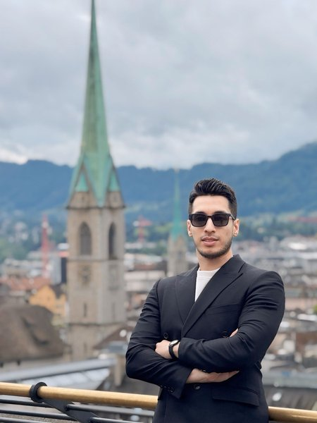

<h1>Farshad Tajeddini</h1>

 

**PhD in Mechanical Engineering, University of Toronto &nbsp;|&nbsp; Toronto, Canada**

 

---

## About Me

Biomedical data scientist and engineer with a PhD in Mechanical Engineering from the University of Toronto, with research experience at University Health Network and the Vector Institute for Artificial Intelligence. My work connects medical imaging, machine learning, and physics-based simulation — translating patient-specific imaging data into clinically actionable models and tools.

I develop and validate AI and ML systems for clinical decision support, design processing pipelines for MRI and CT data, and build computational models of cardiovascular physiology. I prioritize methodological rigor: proper cross-validation, calibration, leakage prevention, and reproducibility from imaging acquisition through to clinical output.

---

## Research and Technical Expertise

**Medical Imaging and Computer Vision**
Segmentation and 3D reconstruction from MRI, CT, and 4D MRI; phase-contrast MRI; image registration; DICOM and NIfTI processing pipelines; intravascular ultrasound; radiomics; MRI acquisition protocol design and multicenter imaging standardization.

**Machine Learning and Clinical AI**
Supervised and unsupervised learning for high-dimensional, small-sample clinical datasets; CNNs, U-Net, MedSAM, ResNet; SVM, random forests, gradient boosting, PLS-DA; leakage-aware validation (LOOCV, stratified cross-validation, calibration curves); clinical performance metrics (AUC, sensitivity, specificity).

**Physics-Based Simulation and Digital Twins**
Patient-specific cardiovascular CFD in ANSYS Fluent and COMSOL; finite-volume methods; fluid-structure interaction; pulse-wave propagation; 4D MRI-informed hemodynamic boundary conditions; physics-informed neural networks for flow reconstruction; reduced-order modeling.

**Scientific Computing and Research Translation**
Python and MATLAB scientific pipelines; numerical methods; MRI acquisition protocol optimization; multicenter imaging standardization; clinical trial support; FDA pre-submission preparation.

---

## Skills and Technologies

**Programming Languages**

 

**Deep Learning and Machine Learning**

 

**Simulation and Scientific Tools**

---

## Projects

> Most research repositories are currently private due to patient data constraints. The projects below are either publicly available or in preparation for release with synthetic or anonymized demonstration data.

### Available Now

**[aortico-landing-page](https://github.com/farshadtajeddini/aortico-landing-page)**
Standalone landing page for the Aortico cardiovascular AI platform.
`HTML` `CSS`

### In Preparation

| Repository | Description |
|---|---|
| `nii-to-stl-aorta-pipeline` | NIfTI label map to STL mesh conversion for cardiovascular geometry |
| `aortic-geometry-processing-toolkit` | Cut planes, centerlines, diameter profiles, and CFD-ready surface preparation |
| `cardiovascular-risk-stratification-ml` | PLS-DA, SVM, and cross-validation pipeline for clinical risk classification |
| `4d-mri-pinn-super-resolution` | Physics-informed neural network for 4D MRI flow reconstruction |
| `medical-image-segmentation-experiments` | PyTorch segmentation workflows: U-Net, CNN, and MedSAM-style experiments |
| `small-sample-clinical-ml-validation` | Utilities for LOOCV, nested CV, calibration, and clinical performance metrics |

---

## Selected Publications

[View full list on Google Scholar](https://scholar.google.com/citations?user=jwl81sUAAAAJ&hl=en)

**Workflow comparison for combined 4D MRI/CFD patient-specific cardiovascular flow simulations of the thoracic aorta**
Tajeddini F, Romero DA, McClarty D, Chung J, Amon CH &nbsp;·&nbsp; *Journal of Fluids Engineering*, 2023

**Type B aortic dissection in Marfan patients after the David procedure: insights from patient-specific simulation**
Tajeddini F, Romero DA, Huang YX, David TE, Ouzounian M, Amon CH, et al. &nbsp;·&nbsp; *JTCVS Open*, 2024

**In silico assessment of aortic hemodynamic sensitivity to inlet boundary conditions: Comparative analysis of 4D MRI, patient-specific, and modified generic waveforms**
Tajeddini F, Huang YX, Romero DA, Chung JCY, Amon CH &nbsp;·&nbsp; *Computer Methods and Programs in Biomedicine*, 2025

**High Precision Invasive FFR, Low-Cost Invasive iFR, or Non-Invasive CFR? Optimum Assessment of Coronary Artery Stenosis Based on Patient-Specific Computational Models**
Tajeddini F, Nikmaneshi MR, Firoozabadi B, Pakravan HA, et al. &nbsp;·&nbsp; *International Journal for Numerical Methods in Biomedical Engineering*, 2020

**Patient-specific fluid-structure interaction simulation of the LAD-ITA bypass graft for moderate and severe stenosis**
Tajeddini F, Firoozabadi B, Pakravan HA, Tafti SHA &nbsp;·&nbsp; *Biocybernetics and Biomedical Engineering*, 2022

**A validated reduced-order dynamic model of nitric oxide regulation in coronary arteries**
Moshfegh H, Tajeddini F, Pakravan HA, et al. &nbsp;·&nbsp; *Computers in Biology and Medicine*, 2021

**Thermal analysis and optimization of a system for water harvesting from humid air using thermoelectric coolers**
Eslami M, Tajeddini F, Etaati N &nbsp;·&nbsp; *Energy Conversion and Management*, 2018

---

## Research Highlights

- Cardiovascular dissection risk stratification across 305 patients, classification AUC 0.90
- Co-inventor on a patent application for AI-driven cardiovascular diagnosis
- Presenter at the American Association for Thoracic Surgery (AATS) Annual Meeting
- Research experience at University Health Network (UHN) and the Vector Institute for Artificial Intelligence

---

## GitHub Stats

&nbsp;

---

## Contact

Open to research collaborations and R&D roles in medical imaging, computational modeling, and clinical AI.

&nbsp;

